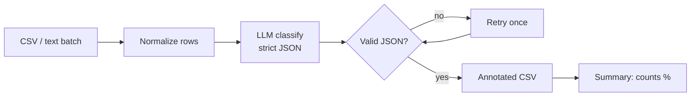

<!-- Banner -->
<p align="center">
  
</p>

# Sentiment / Feedback Classifier


> Classify reviews or messages as positive / negative / neutral, with reasons and a summary.
>
> **Skills:** classification, NLP basics, schema validation · **Level:** 🟡 Intermediate · **Courses:** Gen AI + Intro to AI

---

## Table of Contents
1. [Overview](#overview)
2. [Goals & Objectives](#goals--objectives)
3. [Architecture](#architecture)
4. [Project Structure](#project-structure)
5. [Pro-Level Build Prompt (copy & reuse)](#pro-level-build-prompt-copy--reuse)
6. [Tech Stack](#tech-stack)
7. [Setup](#setup)
8. [Security & Secrets](#security--secrets)
9. [Testing](#testing)
10. [Roadmap](#roadmap)

---

## Overview

Reads a batch of text (reviews, support messages, survey replies), labels each item with sentiment + confidence + a short reason using a strict JSON schema, validates and retries on malformed output, and reports the class distribution. Includes an optional rule-based baseline for comparison.

## Goals & Objectives

**Goal:** Produce reliable, schema-valid sentiment labels at batch scale.

**Objectives**
- Ingest CSV/text batches.
- Classify with strict JSON output + validation.
- Retry once on malformed model output.
- Emit annotated CSV + summary stats.

## Architecture



## Project Structure

```
sentiment-classifier/
├── classify.py             # CLI entrypoint
├── core/
│   ├── io.py               # CSV/text load + write
│   ├── schema.py           # pydantic models
│   ├── classify.py         # LLM call + validation + retry
│   └── baseline.py         # optional rule-based comparison
├── tests/
├── requirements.txt
├── .env.example
└── .gitignore
```

## Pro-Level Build Prompt (copy & reuse)

> Paste the block below into a senior-grade coding assistant (Claude, GPT, Gemini).
> It is written as a full engineering spec: role, context, goals, requirements,
> plan, and constraints. **It explicitly forbids leaking secrets.**

````text
ROLE
You are a senior Python/ML engineer. Deliver modular, commented, tested code.

CONTEXT
Build a "Sentiment / Feedback Classifier" that labels a batch of text items with
sentiment using an LLM API and a strict output schema.

GOAL
Produce reliable, schema-valid sentiment labels at batch scale.

FUNCTIONAL REQUIREMENTS
1. Input
   - CSV (one item per row) or a text file (one item per line).
2. Classification
   - For each item: label in {positive, negative, neutral}, a confidence 0-1,
     and a short reason. Enforce a strict JSON schema (pydantic).
3. Validation + retry
   - Validate the model's JSON; on malformed output, retry once with a
     stricter instruction, then mark as 'error' if still invalid.
4. Output
   - Write an annotated CSV + print a summary (counts and % per class).
5. Optional baseline
   - A simple rule/lexicon classifier to compare against the LLM.

NON-FUNCTIONAL REQUIREMENTS
- Security: API key from .env only; never print it; fail fast if missing.
- Efficiency: batch requests where possible; request timeouts.
- Quality: type hints, docstrings, deterministic tests.

SUGGESTED STRUCTURE
classify.py (CLI) -> core/io.py, core/schema.py, core/classify.py, core/baseline.py

IMPLEMENTATION PLAN
Phase 1: IO + pydantic schema + tests.
Phase 2: LLM classify with validation + retry (mockable client).
Phase 3: summary stats + optional baseline.
Phase 4: CLI + README.

TESTING
- pytest, LLM mocked. Cover: valid output, malformed-then-retry, empty input.

DELIVERABLES
- Source, requirements.txt, .env.example (placeholders), .gitignore, tests.

CONSTRAINTS
- No secret leakage. Minimal pinned dependencies.

````

## Tech Stack

| Layer | Choice | Why |
|---|---|---|
| Language | Python 3.11+ | data-friendly |
| LLM | OpenAI / Gemini | classification |
| Data | `pandas` | CSV in/out + stats |
| Validation | `pydantic` | enforce output schema |
| Config | `python-dotenv` | secret-free |

## Setup

```bash
# 1. Create an isolated environment
python -m venv .venv
source .venv/bin/activate        # Windows: .venv\Scripts\activate

# 2. Install dependencies
pip install -r requirements.txt

# 3. Configure secrets (never commit the real .env)
cp .env.example .env             # then edit .env and add your API key

# 4. Run
python classify.py --input reviews.csv --out labeled.csv
```

## Security & Secrets

- **No keys in code.** All credentials load from `.env` via `python-dotenv`.
- `.env` is git-ignored; only `.env.example` (with placeholder values) is committed.
- The app **fails fast** with a clear message if a required key is missing.
- Never log full prompts/responses that may contain secrets or personal data.
- Pin dependencies in `requirements.txt`; review before upgrading.

```ini
# .env.example  (commit this — values are placeholders)
OPENAI_API_KEY=your_key_here
# GEMINI_API_KEY=your_key_here
MODEL=gpt-4o-mini
```

## Testing

```bash
pytest -q                        # unit tests for core logic (mock the LLM calls)
```

- Mock the LLM client so tests are deterministic and run offline.
- Cover: happy path, empty/invalid input, and malformed model output.

## Roadmap

- [ ] Aspect-based sentiment (price, quality, support)
- [ ] Confusion matrix vs. a labeled test set
- [ ] Small dashboard
- [ ] Active-learning for ambiguous items

---

<sub>Part of the **Tier 2 — AI & Prompt Engineering** demo set. Educational project. MIT License.</sub>
